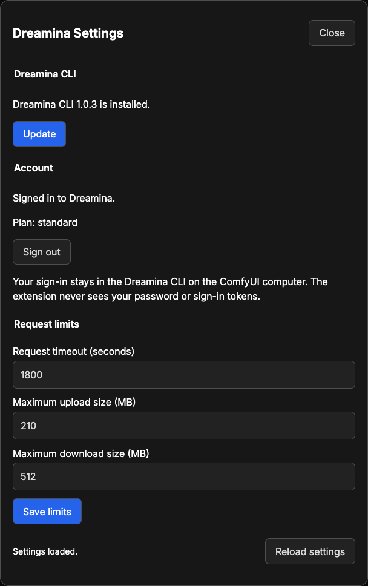

# Dreamina Advanced Guide

Use this guide for sign-in, model settings, references, and recovering generations.
For installation and your first run, see the [README](README.md).
Each node help page covers its [inputs and outputs](README.md#nodes).

## Sign-in and access

In the **ComfyUI menu**, select **Extensions**, then **Dreamina**, then
**Dreamina Settings**. Select **Sign in**, check that Dreamina's page shows the
dialog's code, and approve. The Dreamina CLI keeps the sign-in in your
computer's sign-in store, for your computer user only. The extension never
reads it. **Sign out** clears it.
ComfyUI must run as the user who signed in, on the same computer.

Dreamina Settings works only from a browser on the ComfyUI computer, at a
localhost address. In ComfyUI's multi-user mode it shows the state but
changes nothing. From another computer, or in multi-user mode, run
`dreamina-canvas auth login` on the server as the user that runs ComfyUI.

The private folder holds the settings, the canvas ID, and the run records:

| System  | Folder                                             |
| ------- | -------------------------------------------------- |
| macOS   | `~/Library/Application Support/DreaminaComfyUI`    |
| Linux   | `${XDG_STATE_HOME:-~/.local/state}/dreamina-comfy` |
| Windows | `%LOCALAPPDATA%\DreaminaComfyUI`                   |

To use another folder, set `DREAMINA_COMFY_STATE_DIRECTORY` to an absolute
path outside ComfyUI, the extension, and their media folders. The extension
writes unencrypted files with owner-only permissions.

## Dreamina CLI

The extension needs Dreamina Canvas CLI 1.0.3 or later. It searches
`DREAMINA_CANVAS_INSTALL_DIR`, then the server's `PATH`, then `~/.local/bin`
on macOS/Linux or `%USERPROFILE%\bin` on Windows.

Use **Install** or **Update** in **Dreamina Settings**. Both run the official
installer. For terminal installation, use the command for your system:

- macOS or Linux: `curl -fsSL https://dreamina.capcut.com/canvas-cli/install.sh | bash`
- Windows PowerShell: `irm https://dreamina.capcut.com/canvas-cli/install.ps1 | iex`

The extension checks the CLI version and required commands after installation
or an update. Update the CLI if Dreamina rejects its version; update the
extension if its expected commands are still missing.

## Settings

Change limits in **Dreamina Settings**. New requests use the saved values;
changing settings does not cancel active work. Model limits also apply.

| Setting                        | Default | Range      | What it limits                                                         |
| ------------------------------ | ------- | ---------- | ---------------------------------------------------------------------- |
| **Request timeout (seconds)**  | 1800    | 10 to 3600 | How long one run may take, from the first upload to the last download. |
| **Maximum upload size (MB)**   | 210     | 1 to 210   | Each image, video, or audio file uploaded to your Dreamina canvas.     |
| **Maximum download size (MB)** | 512     | 16 to 4096 | Each output file accepted.                                             |

The CLI also rejects images larger than 30 MB. Your Dreamina account determines
available models and credits.

## Models

Set `model` to a name available to your Dreamina account. **Model: Info**
lists its modes, settings, limits, and voices without starting a generation.
The extension refreshes the model list when a name is not found.

| Node            | Runs models of kind | `model` starts at   | Settings start at                                            |
| --------------- | ------------------- | ------------------- | ------------------------------------------------------------ |
| Image: Generate | `image`             | `seedream_5.0_lite` | `ratio` `1:1`, `resolution` `2K`, `count` 1                  |
| Video: Generate | `video`             | `seedance_2.0_mini` | `ratio` `16:9`, `resolution` `720p`, `duration` 4, `count` 1 |
| Audio: Generate | `audio`             | `seed_audio_v1`     | `voice_name` `Jessie`                                        |
| Image: Upscale  | none                | none                | `mode` `pro`, `resolution` `2K`, `detail` 50                 |

Use the named inputs for common settings. Put other CLI flags in `arguments`
as a JSON object, without leading dashes, such as `{"mode": "m2v"}`.
Do not set a named input again in `arguments`. Node input names use
underscores where CLI flags use dashes.

You can select `mode` and, for speech, `scenario` in `arguments`.
Otherwise, the node chooses:

| Node            | Selection                                                                                          |
| --------------- | -------------------------------------------------------------------------------------------------- |
| Image: Generate | `t2i` without references; `i2i` with images, references, or an Element.                            |
| Video: Generate | `t2v` without media; `first_last_frame` with one or two images alone; `m2v` with other references. |
| Audio: Generate | `text-reading` without media; `omni-dubbing` with media.                                           |

Set `{"mode": "m2v"}` to use one or two images as references instead of frames.
For dubbing, leave `voice_name` empty. The node checks the selected mode's
required inputs, choices, and reference limits before submitting a generation.

## References and uploads

`references` carries what a Dreamina node made to the next, without another upload: the `references` output of a paid node, or the Element from
**Element: Add**. One connection reaches each `references` input. With each
run, the node uploads the ComfyUI images, video, and audio connected to
`images`, `videos`, or `audio` to your canvas. Uploads bill nothing.

The model gets `references` first, then `images`, `videos`, and `audio`,
which matters for `first_last_frame`. Mark where each goes in the prompt with
`{{reference1}}`, `{{image1}}`, `{{video1}}`, or `{{audio1}}` for the first
item of each, and so on. A placeholder for an item that is not connected
stops the node. Write `\{{` to keep a `{{` in the prompt.

The extension uploads local images, video, and audio as PNG, MP4, and WAV respectively.
**Element: Add** groups a character, product, or place with optional views and
a voice for reuse across generations. **Image: Upscale** accepts up to 20 images.

## Credit ceiling

`credit_ceiling` is the maximum credits a generation may cost. Dreamina checks
its price against that ceiling before running it. Dreamina stops a higher-priced generation before billing you. Review the
quoted price before raising the ceiling.
Starting ceilings cover the starting models and settings. Larger outputs,
longer videos, or other models may need a higher ceiling.

Rejected pricing leaves an unrun draft on the canvas. The extension does not
delete canvas nodes. `count` starts at 1 to request one output.

## Caching and reruns

ComfyUI reuses the result of a node while its inputs stay unchanged. Change
`run_number` to request another generation. Signing in to another account
invalidates cached paid results; changing request limits does not.

Each generation uploads its local media again. Connected `references` reuse
existing canvas media. The extension submits each generation once. If the CLI
returns no reply, the extension checks that generation without submitting another.

## Recover a generation

Dreamina cannot cancel an accepted generation. It continues after ComfyUI
cancellation, a restart, or a timeout, and can incur charges.

Use **Generation: Download** to collect a recorded generation. Press R to refresh
the list. A record leaves the list after collection, when Dreamina cannot find
it, or after 30 days. Then look for the output on the Dreamina canvas.

## The canvas

Generations use one canvas named **ComfyUI** in your Dreamina account. The
extension creates it when needed. The `result` output of each node includes a canvas link,
request ID, and generation details. Other Dreamina tools keep their own canvas.
If you delete this canvas, the next run creates another.

## Troubleshooting

| Symptom                                            | Action                                                                                                                  |
| -------------------------------------------------- | ----------------------------------------------------------------------------------------------------------------------- |
| The CLI is missing                                 | Install it in **Dreamina Settings**, or set `DREAMINA_CANVAS_INSTALL_DIR` and restart.                                  |
| The installer finishes but the CLI does not answer | Run `dreamina-canvas version` as the user running ComfyUI. Windows requires 64-bit Intel or AMD.                        |
| Sign-in is missing or expires                      | Sign in again before the dialog's link expires. ComfyUI must run as the same computer user.                             |
| Settings cannot be changed                         | Use localhost on the ComfyUI computer. For remote or multi-user setups, run `dreamina-canvas auth login` on the server. |
| A model is unavailable                             | Check its name with **Model: Info** and confirm your account offers that model kind.                                    |
| An input is rejected                               | Check the selected mode, arguments, connected media, and limits in the node help.                                       |
| A generation outlives the request                  | Recover it with **Generation: Download** before starting another paid generation.                                       |

For an unknown setting or an oversized state file:

Stop ComfyUI and back up the affected file in the private state folder.
To reset limits, remove only `settings.json`, then restart. Keep task records
until you have recovered their outputs. Do not delete the whole state folder
to reset a setting.

## Update or remove

To update, replace `custom_nodes/dreamina`, install its runtime requirements
with ComfyUI's Python, and restart. Open updated examples in a new tab.
**Update** in **Dreamina Settings** updates the CLI separately.

To remove the extension, sign out first if you want to clear the CLI sign-in.
Move its folder outside `custom_nodes` and restart. The private state folder,
CLI, and CLI skill remain. Back up state before deleting it; deleting generation
records removes their entries from **Generation: Download**.
