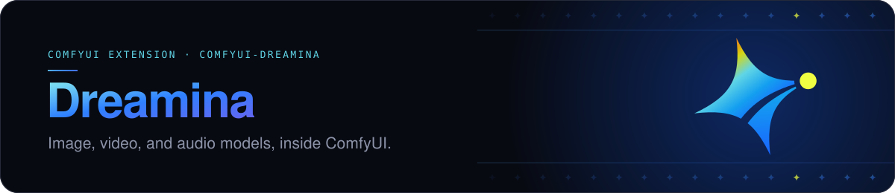

# 

[](#requirements)
[](#requirements)
[](#requirements)
[](LICENSE.md)

Run Dreamina's image, video, and audio models in ComfyUI with your own account.

## Requirements

- Python 3.12 or later.
- ComfyUI 0.37.2 or later, with frontend 1.52.7 or a later version below 2.0.
- A Dreamina account that can use the
  [Dreamina Canvas CLI](https://dreamina.capcut.com/canvas-cli).

Generation uses your Dreamina credits. The extension installs and runs the
Dreamina CLI on the ComfyUI computer.

## Install

Stop ComfyUI. From its `custom_nodes` folder, clone the extension:

```sh
git clone https://github.com/stefanionescu/comfyui-dreamina.git dreamina
```

In Comfy Desktop, use **Manage > About > Location** to find the installation's
`ComfyUI` folder. Its **Terminal** opens that instance's Python environment.

Install runtime dependencies with the Python that runs ComfyUI.
Choose the command for your installation:

**Comfy Desktop**, in its Terminal:

```sh title="Comfy Desktop terminal, in the ComfyUI folder"
pip install -r custom_nodes/dreamina/requirements.txt
```

**macOS or Linux**, from the ComfyUI folder:

```sh title="In the ComfyUI folder"
.venv/bin/python -m pip install -r custom_nodes/dreamina/requirements.txt
```

**Windows**, in PowerShell from the ComfyUI folder:

```powershell title="In the ComfyUI folder"
.\.venv\Scripts\python.exe -m pip install -r .\custom_nodes\dreamina\requirements.txt
```

**Windows portable**, in PowerShell from the folder containing ComfyUI:

```powershell title="Windows portable parent folder"
.\python_embeded\python.exe -m pip install -r .\ComfyUI\custom_nodes\dreamina\requirements.txt
```

Replace `.venv` if your environment has another name. Restart ComfyUI and
reload its window.

## First run

1. Open **Extensions > Dreamina > Dreamina Settings** from the ComfyUI menu.
   Select **Install** if the Dreamina CLI is missing, then **Sign in**.
   Approve the sign-in on dreamina.capcut.com.
2. Open **Browse Templates > dreamina > image-01-design-a-host**.
3. Read **Start Here**, edit the description, and check `credit_ceiling`.
   This is the maximum Dreamina credits the generation may cost.
4. Select **Run**. **Design** shows the image; Dreamina also keeps it on your
   **ComfyUI** canvas.

Generations use your Dreamina credits. Cancelling in ComfyUI stops the wait;
the generation continues. Use **Generation: Download** to collect it later.

Change `run_number` to run again with unchanged inputs. For remote or multi-user
setups, see the [access instructions](ADVANCED.md#sign-in-and-access).

## Example workflows

Open these from **Browse Templates > dreamina**, or load their JSON files.
Read **Start Here** before running. After an update, open examples in a new tab.

| Workflow                                                                                    | Input                                   |
| ------------------------------------------------------------------------------------------- | --------------------------------------- |
| [Image: Design a Host](example_workflows/image-01-design-a-host.json)                       | A host description                      |
| [Image: Edit a Product Photo](example_workflows/image-02-edit-a-product-photo.json)         | A product photo and a change            |
| [Image: Upscale a Poster](example_workflows/image-03-upscale-a-poster.json)                 | A brief                                 |
| [Image: Redraw a Saved Host](example_workflows/image-04-redraw-a-saved-host.json)           | The saved host                          |
| [Image: Place a Host in a Scene](example_workflows/image-05-place-a-host-in-a-scene.json)   | The saved host, a kitchen, and a burger |
| [Audio: Voice a Script](example_workflows/audio-01-voice-a-script.json)                     | A script                                |
| [Audio: Give a Host a Voice](example_workflows/audio-02-give-a-host-a-voice.json)           | A host and a line                       |
| [Video: Animate a Host](example_workflows/video-01-animate-a-host.json)                     | A host and a scene                      |
| [Video: Film a Product Ad](example_workflows/video-02-film-a-product-ad.json)               | A host, a product, and a scene          |
| [Video: Keep a Host across Shots](example_workflows/video-03-keep-a-host-across-shots.json) | A host and two scenes                   |
| [Video: Recover a Video](example_workflows/video-04-recover-a-video.json)                   | A video left running                    |
| [Video: Animate a Saved Image](example_workflows/video-05-animate-a-saved-image.json)       | A saved picture and a scene             |
| [Video: Cast a Saved Host](example_workflows/video-06-cast-a-saved-host.json)               | The saved host and a kitchen            |

Saved-image examples use [sample inputs](example_workflows/assets/), including
Dreamina portraits, a kitchen, and a product photo.

## Nodes

Find the nodes under **Dreamina**. Each linked help page explains its inputs,
outputs, and usage.

| Node                                                           | What it does                                                                             | Paid |
| -------------------------------------------------------------- | ---------------------------------------------------------------------------------------- | ---- |
| [Image: Generate](web/docs/DreaminaImageGenerate.md)           | Makes or edits images with a Dreamina image model.                                       | Yes  |
| [Image: Upscale](web/docs/DreaminaImageUpscale.md)             | Makes images larger and sharper with Dreamina's upscale.                                 | Yes  |
| [Video: Generate](web/docs/DreaminaVideoGenerate.md)           | Makes video from a prompt, frames, or references with a Dreamina video model.            | Yes  |
| [Audio: Generate](web/docs/DreaminaAudioGenerate.md)           | Reads text in a chosen voice, or dubs speech for a picture, with a Dreamina audio model. | Yes  |
| [Element: Add](web/docs/DreaminaElementAdd.md)                 | Makes an Element that keeps a character, product, or place the same across runs.         | No   |
| [Generation: Download](web/docs/DreaminaGenerationDownload.md) | Downloads what Dreamina made for a run after the run stopped.                            | No   |
| [Model: Info](web/docs/DreaminaModelInfo.md)                   | Shows a model's modes, settings, reference and file limits, and voices, as JSON.         | No   |

Use `model` to choose a model available to your Dreamina account.
**Model: Info** shows its modes, settings, limits, and voices without starting
a paid generation. See [models and arguments](ADVANCED.md#models).

## Troubleshooting

| Problem                                 | What to check                                                               |
| --------------------------------------- | --------------------------------------------------------------------------- |
| Nodes or templates are missing          | Install the complete extension, then restart ComfyUI and reload its window. |
| The Dreamina CLI is missing             | Select **Install** in **Dreamina Settings** on the ComfyUI computer.        |
| Sign-in is missing                      | ComfyUI must run as the computer user who signed in.                        |
| The generation exceeds `credit_ceiling` | Check the quoted cost before raising the ceiling and running again.         |
| A cancelled generation was charged      | Collect its outputs with **Generation: Download**.                          |

See the [advanced guide](ADVANCED.md#troubleshooting) for request errors and recovery.

[Advanced guide](ADVANCED.md) · [MIT license](LICENSE.md)
