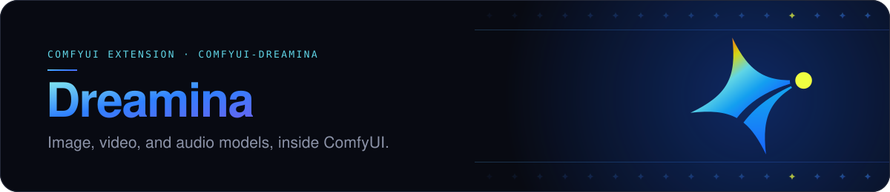
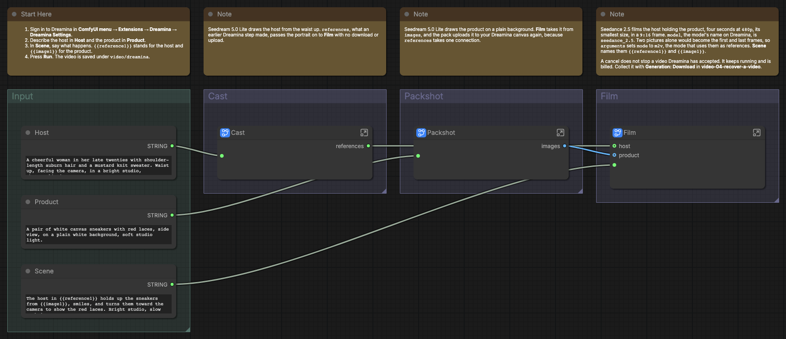
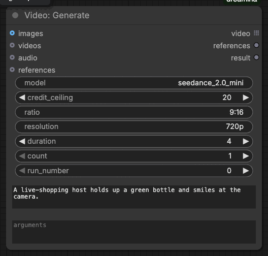

# 

[](#requirements)
[](#requirements)
[](#requirements)
[](LICENSE.md)

Run Dreamina's image, video, and audio models in ComfyUI with your own Dreamina
account.

## Contents

- [Requirements](#requirements)
- [Install](#install)
- [First run](#first-run)
- [Example workflows](#example-workflows)
- [Nodes](#nodes)
- [Models](#models)
- [How a run works](#how-a-run-works)
- [Development](#development)
- [Common problems](#common-problems)
- [License](#license)

## Requirements

- Python 3.12 or later.
- ComfyUI 0.37.2 or later, with frontend 1.52.7 or a later version below 2.0.
- A Dreamina account that can use the
  [Dreamina Canvas CLI](https://dreamina.capcut.com/canvas-cli).

## Install

Put the extension in `ComfyUI/custom_nodes/dreamina`, install its
`requirements.txt` with ComfyUI's Python, and restart ComfyUI.

### Comfy Desktop

1. In the instance chooser, select the **⋮** icon on the instance card, then
   **Manage**.
2. Under **About**, copy **Location**. In that folder, find the `ComfyUI` folder
   that holds `main.py`, and put the extension in its `custom_nodes` folder.
3. Select **Terminal** in the same panel and run:

```sh title="In the ComfyUI folder"
pip install -r custom_nodes/dreamina/requirements.txt
```

### macOS or Linux

From the ComfyUI folder:

```sh title="In the ComfyUI folder"
.venv/bin/python -m pip install -r custom_nodes/dreamina/requirements.txt
```

With uv:

```sh title="In the ComfyUI folder"
uv pip install --python .venv/bin/python -r custom_nodes/dreamina/requirements.txt
```

### Windows

From the ComfyUI folder, in PowerShell:

```powershell
.\.venv\Scripts\python.exe -m pip install -r .\custom_nodes\dreamina\requirements.txt
```

### Windows portable

From the folder that holds `ComfyUI` and `python_embedded`, in PowerShell:

```powershell
.\python_embeded\python.exe -m pip install -r .\ComfyUI\custom_nodes\dreamina\requirements.txt
```

**Dreamina Settings** installs the Dreamina CLI. To install it from a terminal instead:

- macOS or Linux: `curl -fsSL https://dreamina.capcut.com/canvas-cli/install.sh | bash`
- Windows PowerShell: `irm https://dreamina.capcut.com/canvas-cli/install.ps1 | iex`

To update or remove the extension, see the
[advanced guide](ADVANCED.md#update-or-remove).

## First run

1. In the **ComfyUI menu**, select **Extensions**, then **Dreamina**, then
   **Dreamina Settings**. If it says the Dreamina CLI is not installed, select
   **Install**.
2. Select **Sign in**, and approve the sign-in on dreamina.capcut.com.
3. In **Browse Templates**, open **dreamina**, then
   **image-01-design-a-host**, and select **Run**.
4. See your host in **Design** and on the **ComfyUI** canvas in Dreamina.

To send the same run again, change `run_number`.

## Example workflows

| Workflow                                                                                    | Input                                   |
| ------------------------------------------------------------------------------------------- | --------------------------------------- |
| [Image: Design a Host](example_workflows/image-01-design-a-host.json)                       | A host description                      |
| [Image: Edit a Product Photo](example_workflows/image-02-edit-a-product-photo.json)         | A product photo and a change            |
| [Image: Upscale a Poster](example_workflows/image-03-upscale-a-poster.json)                 | A brief                                 |
| [Image: Redraw a Saved Host](example_workflows/image-04-redraw-a-saved-host.json)           | The saved host                          |
| [Image: Place a Host in a Scene](example_workflows/image-05-place-a-host-in-a-scene.json)   | The saved host, a kitchen, and a burger |
| [Audio: Voice a Script](example_workflows/audio-01-voice-a-script.json)                     | A script                                |
| [Audio: Give a Host a Voice](example_workflows/audio-02-give-a-host-a-voice.json)           | A host and a line                       |
| [Video: Animate a Host](example_workflows/video-01-animate-a-host.json)                     | A host and a scene                      |
| [Video: Film a Product Ad](example_workflows/video-02-film-a-product-ad.json)               | A host, a product, and a scene          |
| [Video: Keep a Host across Shots](example_workflows/video-03-keep-a-host-across-shots.json) | A host and two scenes                   |
| [Video: Recover a Video](example_workflows/video-04-recover-a-video.json)                   | A video left running                    |
| [Video: Animate a Saved Image](example_workflows/video-05-animate-a-saved-image.json)       | A saved picture and a scene             |
| [Video: Cast a Saved Host](example_workflows/video-06-cast-a-saved-host.json)               | The saved host and a kitchen            |

They are in **Browse Templates**, under **dreamina**. Start with each workflow's
**Start Here** note. Most steps are subgraphs. Media inputs start empty, and
most workflows make their own inputs with Dreamina models.

The workflows that start from a saved picture name a sample in
`example_workflows/assets/` to upload. `dreamina/` holds pictures these
workflows made with Dreamina, and `live-shopping/` holds a kitchen and a
burger made with GPT Image for the live-shopping workflows.



## Nodes

The nodes are under **Dreamina** in the node menu, and each has a help page.


| Node                                                           | What it does                                                                               | Paid |
| -------------------------------------------------------------- | ------------------------------------------------------------------------------------------ | ---- |
| [Image: Generate](web/docs/DreaminaImageGenerate.md)           | Makes or edits images with any Dreamina image model.                                       | Yes  |
| [Image: Upscale](web/docs/DreaminaImageUpscale.md)             | Makes images larger and sharper with Dreamina's upscale.                                   | Yes  |
| [Video: Generate](web/docs/DreaminaVideoGenerate.md)           | Makes video from a prompt, frames, or references with any Dreamina video model.            | Yes  |
| [Audio: Generate](web/docs/DreaminaAudioGenerate.md)           | Reads text in a chosen voice, or dubs speech for a picture, with any Dreamina audio model. | Yes  |
| [Element: Add](web/docs/DreaminaElementAdd.md)                 | Makes an Element that keeps a character, product, or place the same across runs.           | No   |
| [Generation: Download](web/docs/DreaminaGenerationDownload.md) | Downloads what Dreamina made for a run after the run stopped.                              | No   |
| [Model: Info](web/docs/DreaminaModelInfo.md)                   | Shows a model's modes, settings, reference and file limits, and voices, as JSON.           | No   |

## Models

Type any Dreamina model name in `model`, such as `seedance_2.5`. Nothing in
the extension lists or limits models. When you queue a workflow, and again
when it runs, the node checks the name and your settings against your own
model list from Dreamina, before Dreamina bills anything. **Model: Info**
shows any model's modes, settings, and voices, and bills nothing.



Write the model's settings in `arguments` as JSON, under Dreamina's names,
such as `{"ratio": "9:16", "resolution": "720p", "duration": 5}`. The node
stops if the model makes another kind of output, or does not take a setting
or value you sent. The [advanced guide](ADVANCED.md#models) says how the
node chooses the mode.

## How a run works

1. The node checks your inputs against your model list, and stops before
   Dreamina bills anything.
2. It uploads your images, video, and audio to the **ComfyUI** canvas in your
   Dreamina account, and sends one run with `credit_ceiling`, the most
   credits the run may cost. Dreamina runs it only if its price is within
   that.
3. The node records the run, waits, and downloads the outputs. They also
   carry `references` to what Dreamina made, so the next Dreamina node uses
   it with no download or upload.

The [advanced guide](ADVANCED.md#what-each-node-sends) lists what each node
sends.

## Development

Development needs mise. Point the checks at ComfyUI in `.mise.local.toml`:

```toml
[env]
COMFYUI_PATH = "/path/to/ComfyUI"
COMFYUI_PYTHON = "/path/to/ComfyUI/.venv/bin/python"
```

Install the tools, the dependencies, and the Git hooks:

```shell
mise trust
mise run setup
```

The hooks run gspot on every commit and push. To run every check yourself:

```shell
bun run --no-install gspot check
```

Restart ComfyUI after changing Python. The
[advanced guide](ADVANCED.md#development) lists every task.

## Common problems

| Problem                                 | Fix                                                                                                                   |
| --------------------------------------- | --------------------------------------------------------------------------------------------------------------------- |
| ComfyUI could not find the Dreamina CLI | Select **Install** in **Dreamina Settings**, or run the command under [Install](#install) on the ComfyUI computer.    |
| You are not signed in to Dreamina       | Select **Sign in** in **Dreamina Settings**. ComfyUI must run as the computer user who signed in.                     |
| A run stops above its `credit_ceiling`  | Nothing was billed. Raise `credit_ceiling` to the number the message gives, and run again.                            |
| The model is not in your list           | Copy a name the message suggests, or check it with **Model: Info**. Your Dreamina plan may not offer that model.      |
| A canceled run was billed               | Dreamina cannot stop a run it accepted. Collect its outputs with **Generation: Download**.                            |
| No Dreamina nodes in the menu           | Check that the folder is `ComfyUI/custom_nodes/dreamina` and the console shows no import error, then restart ComfyUI. |
| The templates are missing               | Reinstall the whole extension, including `example_workflows`.                                                         |

More in the [advanced guide's troubleshooting](ADVANCED.md#troubleshooting).

## License

[MIT](LICENSE.md).
